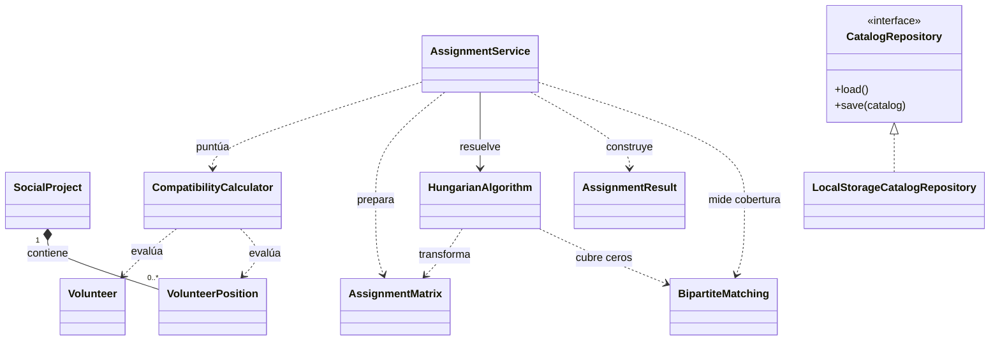
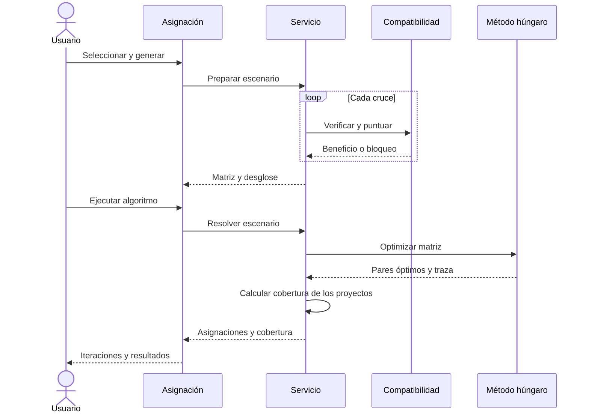

# Volunteer Match

**Connecting skills. Creating impact.**

Volunteer Match es una plataforma de asignación de voluntariado a proyectos sociales. Permite administrar perfiles, registrar los ODS y la organización de cada proyecto, configurar criterios de compatibilidad y resolver la asignación con el algoritmo húngaro.

## Problema y objetivos

Evaluar candidatos en forma aislada puede llevar a una distribución subóptima. Un voluntario con buen puntaje en dos puestos puede ser la única opción adecuada para uno de ellos. La decisión debe considerar la combinación completa de personas, puestos, horarios y requisitos.

El objetivo general es **desarrollar** una aplicación web que maximice la compatibilidad total de la asignación y explique cómo se obtiene la solución. Los objetivos específicos incluyen modelar los cruces, gestionar el catálogo, comprobar la elegibilidad, reproducir el cálculo paso a paso y presentar la cobertura posible y los puestos vacantes.

## Abrir la página descargada

Descomprime el ZIP y haz doble clic en `Volunteer-Match.html`. Si descargaste solo ese archivo, ábrelo directamente con Chrome, Edge o Firefox. El HTML incluye los scripts, estilos, tipografías y la imagen de portada, así que el catálogo, la guía y la asignación funcionan con el archivo local.

Conserva el archivo en la misma ubicación si quieres volver al catálogo que editaste. El navegador guarda ese catálogo para el archivo que abriste.

## Desarrollar el proyecto

La instalación requiere Node.js 22.12 o posterior, npm y un navegador moderno. Las dependencias se instalan con conexión a Internet. El catálogo y los cálculos funcionan en el navegador.

1. Abre una terminal en la carpeta `volunteer-match` que contiene `package.json`.
2. Ejecuta estos comandos.

   ```sh
   npm ci
   npm run dev
   ```

3. Abre la dirección indicada por Vite en la terminal. El puerto de desarrollo predeterminado es 5173.

Estos comandos comprueban tipos, generan el sitio estático en `dist/` y lo previsualizan en un servidor local.

```sh
npm run build
npm run preview
```

Para volver a generar el HTML que se abre con doble clic, ejecuta `npm run build:portable`. El resultado queda en `dist-portable/index.html`.

Ejecuta las pruebas automatizadas con este comando.

```sh
npm test
```

## Recorrido de la aplicación

| Sección | Qué se puede hacer |
| --- | --- |
| Inicio y Acerca de | Consultar el contexto, la definición del problema, la justificación y los objetivos. |
| Marco teórico | Comprender el método, resolver un ejemplo de 3 × 3 paso a paso y consultar la formulación del modelo. |
| Voluntarios | Registrar, consultar, editar y eliminar perfiles con habilidades, intereses, experiencia, disponibilidad y zonas preferidas. |
| Proyectos | Crear y editar iniciativas, sus ODS, la organización y sus puestos con horario obligatorio y bloques de respaldo. |
| Asignación de voluntariado | Seleccionar un escenario, ajustar pesos, generar la matriz e inspeccionar el puntaje o el bloqueo de cada cruce. |
| Resultados | Filtrar la asignación por proyecto u ODS, comparar cobertura y puntaje medio, e identificar qué requisitos descartan candidatos para los puestos vacantes. |
| Conclusiones | Analizar la utilidad, los límites y posibles aplicaciones del modelo. |
| Links de interés | Visitar páginas oficiales de UNV, UNICEF, PNUD, ACNUR, IFRC, ONU Bolivia y UNITAR desde una tabla con logos y descripciones. |

El catálogo inicial contiene 16 voluntarios, cinco proyectos y 12 puestos ficticios. **Restaurar demostración** repone ese catálogo después de confirmarlo. El catálogo se conserva en `localStorage` para el navegador y origen en uso. Las matrices y resultados corresponden a la ejecución en curso, y se recalculan después de cambiar la selección, el catálogo o los pesos.

## Tecnologías y organización

La interfaz usa React, TypeScript, Vite, Tailwind CSS, estilos del proyecto y Lucide. Las pruebas usan Vitest, jsdom y React Testing Library. La tipografía Source Sans 3 se incluye en la aplicación. La portada usa el azul institucional como referencia y una imagen ilustrativa de voluntariado comunitario preparada para el proyecto.

| Ubicación | Responsabilidad |
| --- | --- |
| `src/domain/catalog.ts` | Entidades `Volunteer`, `SocialProject` y `VolunteerPosition`, categorías y bloques semanales. |
| `src/domain/compatibility.ts` | Reglas de elegibilidad y cálculo de beneficios en `CompatibilityCalculator`. |
| `src/domain/matrix.ts` | Validación, balanceo y caminos aumentantes mediante `AssignmentMatrix` y `BipartiteMatching`. |
| `src/domain/hungarian.ts` | Núcleo del método húngaro y registro opcional de su traza. |
| `src/domain/assignment.ts` | Preparación del escenario, solución, línea base voraz y métricas mediante `AssignmentService` y `AssignmentResult`. |
| `src/data/` | Catálogo ficticio, contrato `CatalogRepository` y adaptador de almacenamiento local. |
| `src/ui/` | Vistas, navegación, formularios, tablas, visualizador y cobertura. |
| `src/App.tsx` | Ciclo de vida del catálogo, rutas por hash y estado de la asignación. |
| `tests/` | Pruebas matemáticas, de negocio, persistencia e integración de interfaz. |

El dominio recibe entidades y pesos, y devuelve resultados en TypeScript. El adaptador de almacenamiento mantiene los datos serializables fuera del algoritmo. Una futura API con PostgreSQL requiere un adaptador de persistencia asíncrono y su integración con la interfaz, y puede reutilizar el modelo y el solucionador.

### UML de clases



### Secuencia de la asignación



## Modelo matemático

### Elegibilidad y beneficio

El cruce requiere perfil activo y puesto abierto, disponibilidad en todos los bloques, todas las habilidades específicas solicitadas, las demás habilidades obligatorias y el nivel de experiencia relevante mayor o igual al mínimo del puesto. El nivel registrado es relevante si el voluntario declara experiencia en la categoría del proyecto. El esquema usa bloques de mañana (08:00–12:00) y tarde (14:00–18:00) de lunes a domingo.

| Componente | Beneficio de 0 a 100 | Peso inicial |
| --- | --- | --- |
| Habilidades | 100 × coincidencias / habilidades del puesto. Si el puesto no indica habilidades, el componente vale 100. | 45 % |
| Experiencia | 100 × mín(nivel relevante / nivel deseado, 1). Si el nivel deseado es 0, el componente vale 100. Si la categoría queda fuera de las áreas de experiencia, el nivel relevante es 0. | 20 % |
| Afinidad | 100 si la categoría figura entre los intereses y 0 en caso contrario. | 10 % |
| Flexibilidad | Porcentaje de bloques de respaldo que el perfil puede cubrir. Si el puesto no indica bloques de respaldo, vale 100. | 15 % |
| Ubicación | 100 si la ubicación coincide con una zona preferida o si el perfil no indica preferencias. En caso contrario, vale 0. | 10 % |

El beneficio de cada cruce elegible es la suma ponderada de los cinco componentes dividida entre 100 y redondeada a dos decimales. Los pesos son porcentajes enteros y suman 100 %. Las habilidades y las zonas se comparan sin distinguir mayúsculas ni tildes. Los campos nuevos son opcionales. Las zonas preferidas y los horarios de respaldo solo afectan el puntaje. Cada celda permitida se almacena en centésimas enteras y las prohibidas se representan con `null`.

### Asignación opcional

Para cada cruce elegible se define una variable binaria xᵢⱼ. Se maximiza Z = ∑ᵢ∑ⱼ bᵢⱼxᵢⱼ, con ∑ⱼxᵢⱼ ≤ 1 para cada voluntario y ∑ᵢxᵢⱼ ≤ 1 para cada puesto. Un cruce prohibido tiene xᵢⱼ = 0. Las vacantes y los voluntarios sin asignar están permitidos.

Una selección con v voluntarios y p puestos se extiende a una matriz cuadrada de lado v + p, agregando p filas ficticias y v columnas ficticias. Todo par con algún elemento ficticio aporta cero. Si una asignación parcial tiene k pares, los v − k voluntarios restantes pueden usar columnas ficticias y los p − k puestos restantes pueden usar filas ficticias. Quedan k filas y k columnas ficticias que se pueden emparejar entre sí. A la inversa, al retirar los pares ficticios de cualquier asignación completa se obtiene una solución real del mismo beneficio. Las celdas prohibidas quedan excluidas de las reducciones, coberturas, ajustes y emparejamientos.

Si B es el beneficio máximo permitido, la conversión cᵢⱼ = B − bᵢⱼ produce, para cualquier asignación completa de n = v + p pares, costo nB − Z. Como nB es constante, minimizar costo y maximizar beneficio son equivalentes.

### Método húngaro y traza

1. Resta el mínimo permitido de cada fila y luego el de cada columna.
2. Busca un emparejamiento máximo de ceros mediante caminos aumentantes. Cada camino alterna aristas libres y emparejadas hasta conectar una fila libre con una columna libre.
3. Si el emparejamiento es parcial, el bosque alternante cubre todos los ceros con el conjunto de filas inalcanzables y columnas alcanzables. El tamaño de esa cobertura coincide con el del emparejamiento máximo.
4. Resta el mínimo permitido de las celdas descubiertas y súmalo donde coinciden dos líneas. Cada asignación completa cambia su costo reducido en la misma cantidad, y los ceros emparejados se conservan.
5. Repite hasta obtener n ceros independientes. Todos los costos reducidos permitidos son no negativos, de modo que el costo reducido cero es óptimo. Recupera los beneficios originales y conserva solo los pares reales.

El ejemplo de la guía ejecuta la misma clase en modo completo con una matriz de 3 × 3. El ajuste descubierto es de 10 puntos y la solución total es de 250 puntos. Si en modo completo una cobertura parcial bloquea todos los cruces permitidos, se informa la infactibilidad.

En esta implementación, cada búsqueda y ajuste recorre hasta O(n²) celdas. Cada ajuste amplía el conjunto de columnas alcanzables mientras el emparejamiento se conserva. Hay hasta O(n) ajustes antes de cada nuevo par y hasta n caminos aumentantes exitosos. La cota temporal es O(n⁴) y el espacio de trabajo es O(n²). La traza conserva estados tras los ajustes, con cota espacial O(n⁴). Para mantener manejable la matriz visible, el módulo de asignación admite hasta 25 voluntarios activos y 25 puestos abiertos en cada ejecución.

### Cobertura de los proyectos

Un emparejamiento de máxima cardinalidad sobre las celdas elegibles mide cuántos pares son factibles, aunque sumen menos puntos. Permite detectar tanto un puesto sin candidatos como la competencia de varios puestos por las mismas personas. El objetivo de beneficio puede elegir menos pares que ese máximo. Ante un empate de puntaje, el orden de búsqueda determina cuál óptimo se devuelve.

En el escenario ficticio inicial, la solución suma **1.080,83 puntos** con 11 puestos cubiertos. El puesto de mentoría en accesibilidad queda vacante porque carece de candidatos elegibles. El tablero permite filtrar por proyecto y ODS. Los filtros consultan la solución de la ejecución en curso. El gráfico de bloqueos cuenta cruces de voluntario y puesto para vacantes sin candidatos elegibles. Un mismo cruce puede incumplir varios requisitos y aparecer en más de una barra.

## Validación

| Conjunto | Cobertura |
| --- | --- |
| Solucionador | Matrices cuadradas y rectangulares en ambas orientaciones, vacías, de un elemento, con empates, centésimas y celdas prohibidas. Verifica unicidad, factibilidad completa, mínimos, cobertura y ajuste. |
| Optimalidad | 512 matrices reproducibles de hasta 5 × 5 contrastadas con enumeración exhaustiva. Una matriz de 25 × 23 verifica un resultado de 2.300 puntos con una cota superior conocida. |
| Dominio | Normalización, pesos, experiencia relevante, restricciones, diagnóstico de cobertura, compatibilidad de datos anteriores y catálogo persistente. |
| Interfaz | Generación y desglose de la matriz, resultados, invalidación, reproducción de iteraciones, edición del catálogo y restauración de datos. |

## Límites y posibles extensiones

El puntaje es una aproximación que depende de la calidad de los perfiles y de los pesos elegidos. Cada persona puede cubrir un puesto y cada puesto representa una vacante. Una organización con varios cupos puede registrar un puesto por cupo. El catálogo es local a un navegador y las categorías y los bloques semanales están predefinidos.

Un siguiente modelo podría incorporar horarios de fecha y hora, capacidades múltiples o prioridades explícitas de cobertura. Para coordinación entre equipos se podría agregar persistencia compartida y gestión de acceso mediante una API.

## Referencia

Kuhn, H. W. (1955). *The Hungarian method for the assignment problem*. Naval Research Logistics Quarterly, 2(1–2), 83–97. [https://doi.org/10.1002/nav.3800020109](https://doi.org/10.1002/nav.3800020109)

## Datos de proyectos e identidad visual

Cada proyecto registra varios ODS y una sola organización. El campo ofrece organismos como UNICEF, PNUD, FAO, PMA, OMS/OPS, ACNUR, OIM, ONU Mujeres, UNESCO, UNFPA, FIDA y OIT y admite nombres propios. Al abrir un catálogo anterior, se conserva el aval registrado si estaba cumplimentado. En los demás casos se usa el nombre de la organización que ya estaba guardado.

Las habilidades se seleccionan en una lista que filtra al escribir y permite crear opciones nuevas. El catálogo de habilidades se guarda junto con los registros y conserva los nombres aunque se elimine el perfil o el puesto que los incorporó.

Las habilidades generales predefinidas intervienen en la puntuación. Las habilidades específicas, incluidas las nuevas por defecto, también funcionan como requisitos de elegibilidad cuando un puesto las solicita. El campo de otras habilidades obligatorias permite exigir además una habilidad general. Los cruces que incumplen estos requisitos quedan bloqueados con `null` antes de la optimización.

Inicio calcula el total de voluntarios, proyectos y puestos abiertos a partir del catálogo actual. La tabla de proyectos también usa esos registros y la navegación general se encuentra en la barra superior.

El emblema de Naciones Unidas fue incorporado a solicitud del usuario desde la versión vectorial de Joowwww en Wikimedia Commons. Volunteer Match se presenta como plataforma independiente.

- [Emblema de Naciones Unidas](https://commons.wikimedia.org/wiki/File:UN_emblem_blue.svg)
- [Objetivos de Desarrollo Sostenible del PNUD](https://www.undp.org/es/latin-america/objetivos-de-desarrollo-sostenible)

- [Organismos de Naciones Unidas en Bolivia](https://bolivia.un.org/es/about/un-entities-in-country)
